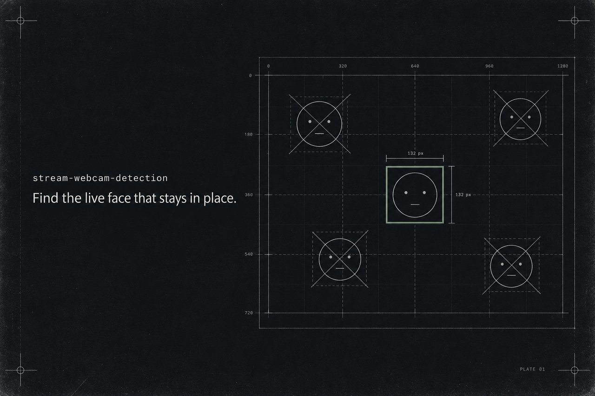

# Stream webcam detection



Offline-детекция **вебки стримера** на кадрах записи стрима: какой прямоугольник кадра показывать, когда из стрима вырезают хайлайт. Без обучения своей модели: готовый детектор лиц YuNet плюс явные правила.

## v2: живые лица (`live/`)

Вторая версия отвечает на главный вопрос иначе: вебка - это **живое** лицо, которое **стоит на одном месте весь стрим**.

1. Лица ищутся на ~5 кадрах клипа в высоком разрешении, чтобы не пропустить маленькую вебку внутри созвона.
2. Лицо считается, только если держится на одном месте минимум на 3 кадрах.
3. Пиксели лица должны меняться между кадрами, снятыми с разницей в десятки секунд. Арт, аватарки и превью неподвижны и отбрасываются.
4. Окно вебки - движущаяся область вокруг лица, ограниченная статичным оформлением стрима.
5. Главная вебка - живое лицо, которое повторяется по всему стриму (12 кадров со всей записи). Другие живые лица добавляются, только если они в том же окне созвона или образуют сетку конференции. Человек внутри смотримого видео не вырезается никогда.

Выход: `webcam` (одна), `multi` (несколько) или `full_frame` (вебки нет или она и так на весь экран).

### Результат

60 размеченных моментов из 19 стримов: набор для разработки (36) и **отложенный набор** (24), размеченный до первого запуска детектора на нём.

| Набор | Моментов | Верно | Частично | Ошибочно |
|---|---:|---:|---:|---:|
| разработка | 36 | 34 | 2 | 0 |
| отложенный | 24 | 24 | 0 | 0 |
| **всего** | **60** | **58** | **2** | **0** |

- «Верно» - все размеченные вебки внутри выданных панелей, и ни одно лицо, которое показывать нельзя (статичная картинка, человек в смотримом ролике), туда не попало.
- «Частично» - конференция, где показан не каждый участник.
- Разметку делал ИИ-агент визуально, а не человек-разметчик. Это слабое место оценки, и оно названо честно.
- Кадры не распространяются: они чужие. Источники заменены непрозрачными метками `src_NN`. В репозитории есть разметка (`live/labels-*.json`) и сохранённый ответ детектора (`live/results-*.json`), поэтому подсчёт можно перепроверить:

```sh
python live/evaluate.py --results live/results-dev.json live/labels-dev.json
python live/evaluate.py --results live/results-holdout.json live/labels-holdout.json
python -m unittest live/test_live_cams.py      # синтетические тесты правил
```

Чтобы прогнать детектор на своих кадрах, разложите их как описано в начале `live/evaluate.py`.

## v1: эксперимент с панелью (`experiment/`)

Первая версия: лица предлагают область поиска, а прямоугольник панели подтверждается границами и сходством содержимого на каждом кадре отдельно. Это исследовательский прогон, а не production-детектор.

### Что уже проверено

На трёх development-клипах (144 разреженных кадра + 36 дополнительных) и 50 независимо размеченных сэмплах:

| Клип | Верно найдены панели (размеченные кадры) | Средний IoU |
|---|---:|---:|
| clip_1 | 12/12 | 0.990 |
| clip_2 | 12/13 | 0.990 |
| clip_3 | 21/22 | 0.994 |

- Панель подтверждена на **7 кадрах без обнаруженного лица** (ведущий отвернулся, лицо перекрыто) — но не переносом старого бокса, а повторной проверкой границ и содержимого.
- На 3 размеченных кадрах без целевой панели ложный бокс не выдан.
- Два пропуска имеют понятную причину: слабый верхний край (clip_2, кадр 32) и почти чёрная панель другого размера (clip_3, кадр 6).

Числа и координаты лежат в `experiment/panel-evaluation.json` и `experiment/panel-results.json`. Визуальный отчёт и контактные листы генерируются локально скриптами и **намеренно не публикуются**: они содержат кадры сторонних роликов. Команды сборки — в разделе «Воспроизведение».

**Это результат на видео, по которым разрабатывались правила** — не независимый benchmark.

## Структура

```
live/                       # v2
  live_cams.py              # детектор живых вебок
  evaluate.py               # подсчёт верно/частично/ошибочно по разметке
  test_live_cams.py         # синтетические тесты правил
  labels-dev.json           # разметка: набор для разработки (36)
  labels-holdout.json       # разметка: отложенный набор (24)
  results-*.json            # сохранённый ответ детектора
  yunet.onnx                # детектор лиц YuNet (OpenCV Zoo)
experiment/                 # v1
  probe.py                  # эксперимент 1: детекция лиц, повторяемость (Haar vs YuNet)
  panel_probe.py            # эксперимент 2: границы панели, appearance-проверка, отказы
  panel_report.py           # сравнение с разметкой, HTML-отчёт
  summarize.py              # отчёт эксперимента 1
  test_panel_probe.py       # синтетические unit-тесты (37)
  panel-results.json        # предсказания, причины, debug-признаки
  panel-reference.json      # независимая ручная разметка (не читается кодом)
  panel-evaluation.json     # IoU, ошибки сторон, пропуски, счётчики исходов
  results.json              # детекции лиц и параметры эксперимента 1
  sampling-comparison.json  # сравнение подвыборок 3/12/24/48 кадров
  clips.json                # список локальных клипов (метки, без источника)
  requirements.txt
implementation-plan.html    # черновик плана (W5): решения и риски
implementation-notes.md     # журнал отклонений и находок (W6)
```

## Воспроизведение

Репозиторий не содержит и не указывает исходное видео: вместо него — собственные клипы. Нужны `experiment/yunet.onnx` (в репозитории) и файлы клипов в корне проекта по именам из `experiment/clips.json` (`clip_1.mp4`, `clip_2.mp4`, `clip_3.mp4`). Порядок клипов задаёт только локальный манифест; ID, названия и источники в репозитории не записываются.

Контактные листы и HTML-отчёты создаются локально и не публикуются: они содержат кадры, права на которые принадлежат не этому репозиторию. Результаты читаются из JSON.

```sh
python -m venv .venv
.venv/bin/pip install -r experiment/requirements.txt

# положите свои клипы как clip_1.mp4, clip_2.mp4, clip_3.mp4
# (или отредактируйте experiment/clips.json под свои файлы)

# эксперимент 1, затем 2
.venv/bin/python experiment/probe.py
.venv/bin/python experiment/summarize.py
.venv/bin/python experiment/panel_probe.py
.venv/bin/python experiment/panel_report.py

# тесты
.venv/bin/python -m unittest discover -s experiment -p 'test_panel_probe.py'
```

`experiment/panel_probe.py --skip-dense` пропускает дополнительные локальные сэмплы. Алгоритм работает локально и не обращается к внешним API.

## Контракт результата

- `detected` — `bbox_px = [x, y, width, height]` в исходном разрешении и `webcam = {x, y, w, h}` в долях кадра; правая/нижняя границы исключающие.
- `ambiguous` / `not_detected` — `bbox_px = null` и `webcam = null`. `not_detected` означает нехватку свидетельств, а не доказанное отсутствие камеры.
- `candidate_bbox_normalized` — debug-гипотеза, а не подтверждённая панель.
- score и расстояния — эвристики, не вероятности.

## Ограничения

- Только прямоугольные панели, у которых две стороны совпадают с краями кадра. Нет свободно плавающих панелей, chroma key, круглых масок, нескольких равноправных ведущих.
- Нет непрерывного трекинга и точных временных сегментов: решения принимаются в сэмплированных точках, между ними ничего не гарантируется.
- Основная геометрия и appearance-банк строятся по всему ролику, включая будущие кадры, — это **не** live-режим.
- Найденная рамка и сходство содержимого не доказывают семантически, что это именно вебка ведущего.
- Три отсутствующих панели — слишком мало для оценки доли ложных срабатываний.

## Лицензии и сторонние материалы

- `experiment/yunet.onnx` — YuNet (OpenCV Zoo, MIT), модель из [opencv_zoo](https://github.com/opencv/opencv_zoo/tree/main/models/face_detection_yunet).
- Кадры сторонних YouTube-роликов в репозитории **не распространяются**: контактные листы и встроенные изображения исключены через `.gitignore`. Локально сгенерированные копии не покрыты лицензией этого репозитория.
- Код в репозитории лицензией пока не покрыт.
